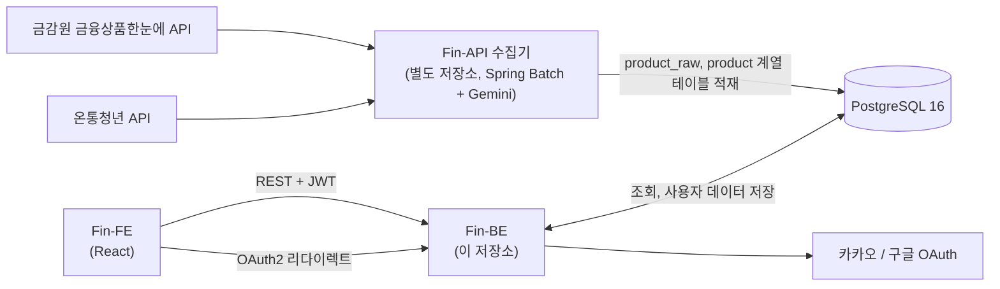
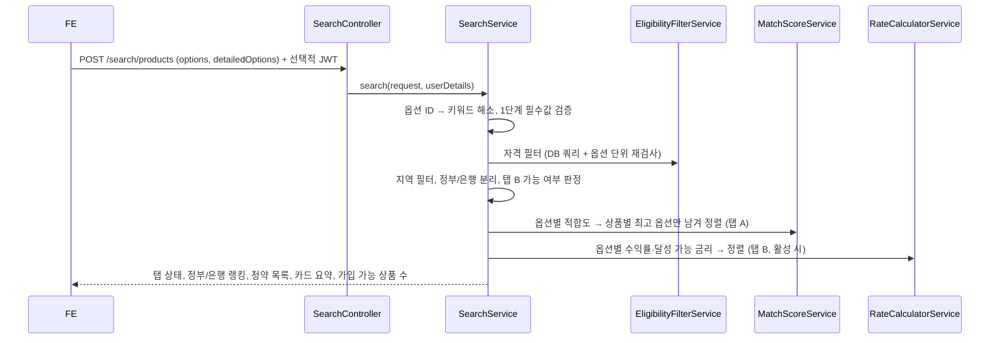

# 아키텍처

> 기준: `main` 브랜치 (2026-10). 이 저장소는 Y-Fin. 백엔드(Fin-BE)다.

## 시스템 구성

- **수집기(Fin-API)**: 공공 API 원본을 `product_raw`에 쌓고, 비정형 우대조건·자격 텍스트를 LLM으로 구조화해(`llm_enrichment_cache`) `product`, `product_properties`, 키워드·우대금리 테이블에 정규화해 넣는다. 이 저장소에는 수집기 코드가 없고, 수집기용 테이블의 스키마(V3, V4)만 같은 Flyway 이력으로 관리한다.
- **백엔드(Fin-BE)**: 상품 데이터는 읽기만 하고, 사용자·프로필·약관 동의·찜·리프레시 토큰을 쓴다. 추천 점수와 금리는 요청마다 메모리에서 계산한다(사전 계산 테이블 없음). 캐시는 키워드 옵션 매핑(`keywordOptionMap`, `keywordOptionMappings`)과 중위소득(`medianIncome`)에만 쓴다.
- **프론트엔드(Fin-FE)**: 비로그인 권한 분기, 1단계 입력 보존, GA4 이벤트, 금융 용어 풀이는 FE 책임이다.

## 기술 스택

| 구분 | 사용 |
| --- | --- |
| 언어·런타임 | Java 21 |
| 프레임워크 | Spring Boot 4.0.3 (Web, Data JPA, Security, OAuth2 Client, Validation, Cache, Flyway) |
| 인증 | OAuth2 로그인(카카오, 구글) + JWT(jjwt 0.12), 리프레시 토큰은 HttpOnly 쿠키 |
| DB | PostgreSQL 16 (로컬은 `pgvector/pgvector:pg16` 이미지), Flyway 마이그레이션, JPA `ddl-auto: validate` |
| API 문서 | springdoc-openapi (Swagger UI는 `dev`, `test` 프로필에서만 열림) |
| 테스트·품질 | JUnit 5, Spring Security Test, Testcontainers(PostgreSQL), JaCoCo, PMD·CPD (GitHub Actions) |

## 패키지 구조

`src/main/java/apptive/fin/` 아래 도메인별 패키지에 `controller / service / repository / entity / dto`를 둔다.

| 패키지 | 책임 | 주요 엔드포인트 |
| --- | --- | --- |
| `auth` | OAuth2 로그인 처리, JWT 발급·검증, 리프레시 토큰 회전, 로그아웃 | `/oauth2/authorization/{kakao,google}`, `/auth/refresh`, `/auth/logout` |
| `user` | 회원 정보, 탈퇴, 추천 입력 프로필 저장(Y5-2), 역할(`UserRole`) | `/user/me`, `/user/me/profile` |
| `term` | 약관·버전 조회, 동의 기록, 필수 동의 완료 시 역할 승격 | `/term` |
| `category` | 1·2단계 입력 키워드 카테고리와 옵션 | `/api/categories` |
| `provider` | 금융기관(은행) 목록, 은행 분류(시중·지방·특수·인터넷) | `/providers/banks` |
| `search` | 동적 폼, 자격 필터, 적합도·금리 계산, 추천 리스트, 상품 상세, 상품명 검색 | `/search/**` |
| `calculator` | 예금·적금 수익률 계산기(Y4-1) | `/calculator` |
| `myfin` | 찜해둔 Fin.(Y5-1) | `/favorites/**` |
| `global` | 보안 설정, 공통 예외·에러 응답, 설정 프로퍼티, JSON 컨버터, 나이 계산 등 | |

개발용 DB 초기화 도구는 별도 소스셋 `src/reset/java`(`ResetDatabase`)에 있다. [개발 가이드](development.md) 참고.

## 요청 흐름 예시: 맞춤 상품 추천

세부 로직은 [추천 엔진](recommendation-engine.md)에 있다.

## 에러 응답

도메인별 `*ErrorCode` enum(HTTP 상태, 코드, 메시지)을 `BusinessException`으로 던지고 `GlobalExceptionHandler`가 `ErrorResponseDto`로 바꾼다. 인증 실패와 권한 부족은 `BusinessAuthenticationEntryPoint`, `BusinessAccessDeniedHandler`가 같은 형식으로 응답한다.

## 외부 문서

- API 엔드포인트 목록: 저장소 루트 [README](../../README.md)의 API 명세. 요청·응답 스키마는 dev 프로필 Swagger UI(`/swagger-ui.html`).
- 기획 원문: [docs/planning](../planning/)
