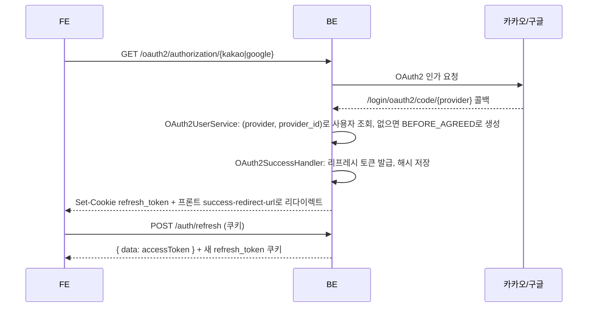

# 인증과 접근 제어

> 기획: [Y1 회원가입·로그인과 약관](../planning/y1-auth-and-terms.md), [기능 맵의 로그인 상태별 허용 범위](../planning/feature-map.md#로그인-상태별-허용-범위) · 코드: `auth`, `term`, `user`, `global/config/SecurityConfig.java`

## 로그인 흐름

- 가입과 로그인은 같은 흐름이다. 최초 로그인 시 `users`에 행을 만든다(`uq_users_provider_account`).
- 로그인 직후에는 액세스 토큰을 바로 주지 않는다. 프론트가 리다이렉트를 받은 뒤 `/auth/refresh`로 액세스 토큰을 얻는다.

## 토큰

| 토큰 | 형식 | 저장 위치 | 만료 (dev 설정) |
| --- | --- | --- | --- |
| 액세스 토큰 | JWT (HMAC). `sub` = 사용자 ID, `role`, `required_terms_agreement` 클레임 | 프론트 메모리, `Authorization: Bearer` 헤더 | `jwt.expiration` 600초 |
| 리프레시 토큰 | 무작위 바이트의 Base64 | `refresh_token` HttpOnly 쿠키. DB에는 SHA-256 해시만 저장 | `jwt.refresh_expiration` 86400초 |

- `/auth/refresh`는 리프레시 토큰을 **회전**한다. 기존 토큰을 비활성화(`deactivateIfActive`, 조건부 업데이트라 동시 요청 중 하나만 성공)하고 새 토큰을 쿠키로 내려준다. 이미 쓴 토큰을 다시 보내면 401.
- `/auth/logout`은 토큰 행을 지우고 `maxAge=0` 쿠키를 내려준다.
- 쿠키 `Secure`, `SameSite`는 `app.cookie.*` 설정을 따른다(로컬은 `false`, `Lax`).

## 역할 (`UserRole`)

| 역할 | 의미 | 부여 시점 |
| --- | --- | --- |
| `BEFORE_AGREED` | 가입했지만 필수 약관 미동의 | 최초 가입 |
| `RECOMMENDATION` | 추천 개인화 기능 사용 가능 | 필수 약관을 모두 동의한 순간 `TermService`가 승격 |
| `ADMIN` | 관리자 | 수동 |

`JwtAuthFilter`는 토큰의 `required_terms_agreement`가 false면 토큰의 역할과 관계없이 `BEFORE_AGREED`로 인증 객체를 만든다. 약관 동의 직후에는 `/auth/refresh`로 새 토큰을 받아야 새 역할이 반영된다.

## 엔드포인트 접근 규칙

`SecurityConfig`의 공개 경로 외에는 인증이 필요하고, 일부는 메서드 보안(`@PreAuthorize`)으로 역할을 더 본다.

| 경로 | 비로그인 | `BEFORE_AGREED` | `RECOMMENDATION`, `ADMIN` |
| --- | --- | --- | --- |
| `/oauth2/authorization/**`, `/login/oauth2/**` | O | O | O |
| `POST /auth/refresh`, `POST /auth/logout` | O (쿠키 필요) | O | O |
| `GET /api/categories`, `GET /providers/banks` | O | O | O |
| `POST /search/dynamic-form`, `GET·POST /search/products`, `POST /search/products/{id}/detail` | O | O | O |
| `GET·POST /term` | X | O | O |
| `GET·PATCH·DELETE /user/me` | X | O | O |
| `GET·PUT·DELETE /user/me/profile` | X | X | O |
| `/favorites/**` | X | X | O |
| `POST /calculator` | X | X | O |
| Swagger (`/swagger-ui/**`, `/v3/api-docs/**`) | `dev`, `test` 프로필에서만 공개, 그 외 차단 | | |

추천·상세 API는 공개지만, 응답 안의 개인화 수치(탭 B, 달성 가능 금리, 기여금 환산 수익률)는 `SearchRequestPolicy.canUsePersonalization`이 역할과 입력 완료 여부를 보고 연다. 즉 "누가 호출할 수 있는가"는 Security가, "무엇을 보여주는가"는 서비스 정책이 정한다.

## 약관 (`term`)

- `terms`(약관 종류, 필수 여부) → `term_versions`(major·minor 버전, 제목, 전문, `is_current`, 시행일) → `user_term_agreements`(사용자, 버전, 동의 여부, 동의 시각).
- 약관별 현재 버전은 하나만 둘 수 있다(`uq_term_version_current_per_term` 부분 유니크 인덱스).
- 시드 약관: `SERVICE_TERMS`(필수), `PRIVACY_POLICY`(필수), `LOCATION_SERVICE_TERMS`(선택), `MARKETING_TERMS`(선택). 전문은 `V2__insert_reference_data.sql`.
- `GET /term`: 현재 버전 약관과 사용자의 동의 상태. `POST /term`: 동의 결과 저장. 필수를 모두 동의하면 역할 승격.

## 회원 정보와 탈퇴 (`user`)

- `GET /user/me`, `PATCH /user/me`(이메일 중복 검사 포함), `DELETE /user/me`.
- 탈퇴는 `users` 행을 지우고, 리프레시 토큰·프로필·약관 동의·찜은 FK `ON DELETE CASCADE`로 함께 지워진다.

## 환경 변수

| 변수 | 용도 |
| --- | --- |
| `JWT_SECRET` | JWT 서명 키 |
| `GOOGLE_CLIENT_ID`, `GOOGLE_CLIENT_SECRET` | 구글 OAuth |
| `KAKAO_CLIENT_ID`, `KAKAO_CLIENT_SECRET` | 카카오 OAuth |

로컬에서는 저장소 루트 `.env`(git 미추적)에서 읽는다(`spring.config.import: optional:file:.env[.properties]`). 프론트 주소와 리다이렉트 경로는 `app.frontend.url`, `app.oauth2.*`로 설정한다.

배포 서버는 `server` 프로필(`application-server.yml`)을 함께 켠다(dev 서버 `dev,server`, 운영 `server`). 이 프로필은 리프레시 토큰 쿠키를 `Secure`, `SameSite=None`으로 바꾸고, nginx가 넘긴 `X-Forwarded-*` 헤더로 https 리다이렉트 URL을 만들며, 프론트 주소를 `FRONTEND_URL` 환경 변수로 받는다. 서버 환경 변수는 [배포](deployment.md#github-environment) 참고.
