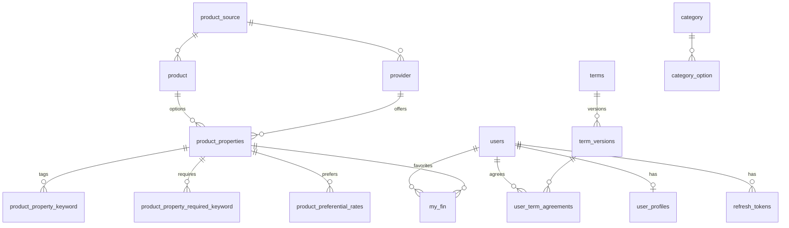

# 데이터 모델

> 코드: `src/main/resources/db/migration`, 엔티티는 각 도메인의 `entity` 패키지

스키마는 Flyway로 관리하고 JPA는 `ddl-auto: validate`로 스키마와 엔티티가 맞는지만 확인한다. 스키마를 바꿀 때는 새 `V{n}__*.sql`을 추가하고 기존 파일은 고치지 않는다.

## 마이그레이션 이력

| 버전 | 내용 |
| --- | --- |
| V1 | 애플리케이션 스키마 전체 (사용자, 토큰, 프로필, 중위소득, 약관, 카테고리, 상품 계열, 찜) |
| V2 | 기준 데이터: 2026 중위소득, 약관 4종과 v1.0 전문, 카테고리 6종과 옵션 |
| V3 | 수집기용 테이블 `product_raw`, `llm_enrichment_cache` |
| V4 | `llm_enrichment_cache` 실패 횟수·시각 컬럼 보강 |
| V5 | `product.original_name` 추가. `product_name`은 괄호를 뺀 표시용 이름, 원본은 `original_name` |
| V6 | 예금 예치 한도 분리. `min/max_monthly_limit`은 적금 월 납입 한도 전용, 예금은 `min/max_deposit_amount` |
| V7 | (`main`에 없음) PR #36이 저축기간 개월 옵션(`TERM_1_MONTH` 등)을 추가하는 데 쓴다 |
| V8 | 파킹 카드용 `max_rate_applicable_min/max_amount`(최고금리 적용 잔액 범위, 하한 초과·상한 이하), `interest_payment_method`(이자지급방식 원문). 예치 한도 `min/max_deposit_amount`는 예금과 파킹이 같이 쓴다 |

`spring.flyway.baseline-version: 2`, `baseline-on-migrate: true`로 Flyway 도입 이전에 만든 DB도 V3부터 이어서 적용할 수 있다.

## 관계도

## 상품 계열 테이블

수집기가 쓰고 백엔드는 읽는다.

### `product_source`, `provider`

- `product_source`: `FSS`(금융감독원, 은행 상품), `ONTONG`(온통청년, 정부 상품). 코드에서는 `Product.isBank()`, `isGovernment()`로 구분한다.
- `provider`: 금융기관·주관기관. `code`는 금감원 금융회사 코드(은행)이고 거래 이력(`neverUsedBanks` 등)과 맞춰 볼 때 쓴다. `apply_url`은 기관 공식 신청 채널(아웃링크 폴백).

### `product`

상품 단위 정보. `type`(`DEPOSIT` 예금, `SAVING` 적금, `POLICY` 정책, `SUBSCRIPTION` 청약), `product_code`, `product_name`, `original_name`, 상세 화면용 텍스트(`content`, `content_summary`, `join_method`, `eligibility_text`, `caution_text`, `recruitment_period`).

### `product_properties` (옵션)

자격 판정·점수·금리 계산의 실제 단위다.

| 묶음 | 컬럼 | 의미 |
| --- | --- | --- |
| 금리 | `base_rate`, `max_rate` | 기본·최고 금리 (%) |
| | `intr_rate_type`, `rsrv_type`, `save_trm` | 단리/복리, 정액/자유 적립, 저축 기간(개월) |
| 정부 기여금 | `gov_contribution_type` | `NONE` / `RATIO`(정률) / `FIXED_AMOUNT`(정액) |
| | `gov_matching_ratio` | 정률 매칭 배수 (예: 1.0 = 1:1) |
| | `gov_monthly_fixed_contribution` | 정액 월 매칭액 (원) |
| | `gov_contribution_period_months` | 기여 기간. 없으면 `save_trm` |
| | `gov_contribution_rate` | 환산 수익률 값(%)이 들어 있지만 백엔드 코드는 읽지 않는다. 수익률은 매칭 배수·정액으로 매번 계산한다 |
| | `exclude_from_rate_comparison` | true면 탭 B 비교에서 제외 |
| 납입 | `min/max_monthly_limit` | 적금 월 납입 한도 |
| | `min/max_deposit_amount` | 예금·파킹 예치 한도 (V6) |
| 파킹 | `max_rate_applicable_min/max_amount`, `interest_payment_method` | V8. `main`에서는 엔티티 미매핑, PR #37에서 매핑 |
| 자격 | `min_age`, `max_age` | 연령 |
| | `earn_max_amt`, `earn_percent` | 개인 소득 상한(원), 가구 중위소득 % 상한 |
| | `min_tenure_months` | 최소 근속 |
| | `requires_homeless`, `requires_householder` | 무주택·세대주 요건 |
| | `allows_military_age_extension`, `military_max_age` | 병역 연령 연장. 현재 필터에서 쓰지 않는다 |
| 상태 | `is_joinable` | false면 모집 종료·판매 종료. 필터·검색·찜 추가에서 제외 |
| | `apply_url` | 상품 단위 신청 URL |
| | `variant_code` | 같은 상품의 유형 구분 (시드 예: `GENERAL` 일반형 / `PREFERENTIAL` 우대형) |

### 옵션에 붙는 키워드

| 테이블 | 내용 |
| --- | --- |
| `product_property_keyword` | 표시·매칭용 태그 (`REGION_*`, `TERM_*`, `BENEFIT_*` 등) |
| `product_property_required_keyword` | 가입 신분 조건. `effect`: `REQUIRE`/`EXCLUDE`, `confidence`: LLM 추출 신뢰도. 필터는 `HIGH`만 쓴다 |
| `product_preferential_rates` | 우대금리 행. `keyword_code`(`BANK_*`), `rate`(%p), `description`, 연령 우대는 `min_age`/`max_age` |

`ProductProperty.keywordCodes()`는 세 테이블을 합친 키워드 집합(태그 + 우대금리 키워드 + `REQUIRE`·`HIGH` 신분 조건)을 돌려준다. 적합도 계산은 이 집합을 쓴다.

키워드 코드 전체는 `KeywordValueEnum`에 있다. 접두어로 의미를 나눈다: `REGION_`(지역), `STATUS_`(신분, 가입 자격), `TERM_`(저축 기간), `BENEFIT_`(혜택), `INTEREST_`(상품 관심사), `BANK_`(우대금리 조건).

## 사용자 계열 테이블

| 테이블 | 내용 |
| --- | --- |
| `users` | OAuth 제공자와 ID, 이름, 이메일, `user_role` |
| `refresh_tokens` | 토큰 SHA-256 해시, 활성 여부, 만료 |
| `user_profiles` | 추천 입력 저장값(Y5-2). 생년월일, 연 소득, 가구원 수·소득 %, 근속, 첫 직장, 무주택·세대주, 월 납입 희망액, 거래 이력 은행 코드 목록, 1단계 선택 옵션 ID 목록(`selected_option_ids`). 목록 컬럼은 JSON 문자열(`LongListJsonConverter`, `StringListJsonConverter`). `main_banks`는 롤백용으로 남긴 미사용 컬럼 |
| `user_term_agreements` | 약관 버전별 동의 여부·시각 |
| `my_fin` | 찜. (사용자, 옵션) 유니크 |

## 기준 데이터

| 테이블 | 내용 |
| --- | --- |
| `median_incomes` | 연도 × 가구원 수 × 중위소득 % → 월 소득(만 원). 2026년 값 |
| `category`, `category_option` | 입력 키워드. 카테고리 ID 1~6은 `CategoryIdEnum`과 일치해야 한다 |
| `terms`, `term_versions` | 약관 |

## 수집기 테이블 (V3, V4)

백엔드 코드는 이 테이블을 쓰지 않는다.

- `product_raw`: 출처·외부 ID별 원본 JSON, 내용 해시, 마지막 수집·정규화 시각, 정규화기 버전
- `llm_enrichment_cache`: (출처, 외부 ID, 내용 해시, 제공자, 모델, 프롬프트 버전, 스키마 버전) 단위 LLM 응답 캐시와 실패 기록

## 시드 데이터

`src/main/resources/seed/01~06-*.sql`은 수집 결과를 덤프한 개발용 상품 데이터다. Flyway 마이그레이션이 아니며 `resetDb` 태스크로만 넣는다. 공제부금형 정부 상품(기획의 그룹 2)은 넣지 않았다.
