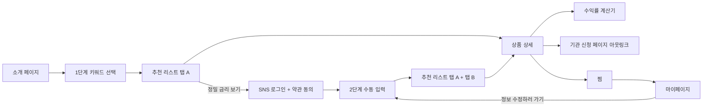

# 기능 맵

> 원본: 노션 「기능 정의서」(기능정의서 DB), 「Y2 소개/탐색 PRD」, 각 PRD

기능 ID는 노션 기능 정의서의 체계를 따른다. `Y`는 P0(출시 기능), `A`는 상품 추천 확장, `B`는 리텐션 기능이다.

## 기능 목록

| ID | 기능 | 화면 | 기획 문서 | 상태 |
| --- | --- | --- | --- | --- |
| Y1-1, Y1-3 | 카카오·구글로 시작하기 (가입) | 팝업 | [Y1](y1-auth-and-terms.md) | 완료 |
| Y1-2, Y1-4 | 카카오·구글 로그인 | 팝업 | [Y1](y1-auth-and-terms.md) | 완료 |
| Y1-5 | 필수 약관 동의 (만 14세, 이용약관, 개인정보 수집·이용) | 모달 | [Y1](y1-auth-and-terms.md) | 완료 |
| Y1-6 | 선택 약관 동의 (위치기반, 마케팅·프로파일링) | 모달 | [Y1](y1-auth-and-terms.md) | 완료 |
| Y2-1 | 소개(랜딩) 페이지 스크롤 | 페이지 | [Y2](y2-landing-and-explore.md) | 완료 |
| Y2-2 | 비로그인 탐색 | 페이지 | [Y2](y2-landing-and-explore.md) | 완료 |
| Y2-3 | 비로그인 제한 기능 클릭 시 로그인 유도 모달 | 모달 | [Y2](y2-landing-and-explore.md) | 완료 |
| Y3-1 | 정보 입력 (1단계 키워드, 2단계 수동 입력) | 페이지 | [Y3-1](y3-1-input.md) | 완료 |
| Y3-2 | 추천 리스트 (탭 A 적합도 순, 탭 B 달성 가능 금리 순) | 페이지 | [Y3-2](y3-2-recommendation-list.md) | 완료 |
| Y3-3 | 입력 정보 저장 여부 확인 모달 | 모달 | [Y1 약관](y1-auth-and-terms.md#입력-정보-저장-동의) | 2순위 |
| Y4 | 상품 상세 페이지 | 페이지 | [Y4](y4-product-detail.md) | 완료 |
| Y4-1 | 수익률 계산기 (은행 상품, 예금/적금 분기) | 모달 | [Y4](y4-product-detail.md#y4-1-수익률-계산기) | 완료 |
| Y4-2 | 금융상품 신청 아웃링크 | 페이지 | [Y4](y4-product-detail.md#y4-2-아웃링크-신청) | 완료 |
| Y4-3 | 관심 상품 찜하기·해제 (하트) | 내부 요소 | [Y5](y5-mypage.md) | 완료 |
| Y5-1 | 찜해둔 Fin. (관심 상품 비교 캐러셀) | 페이지 | [Y5](y5-mypage.md) | 완료 |
| Y5-2 | 개인정보 확인·수정 | 페이지 | [Y5](y5-mypage.md) | 완료 |
| A1~A3 | 정보입력·필터 확장, 파킹통장, 단기 예적금(3개월 이하) | | [A1~A3](a1-a3-product-expansion.md) | 구현 중 (draft PR #36, #37) |
| B1 | 정부상품 캘린더 | | [B1](b1-government-calendar.md) | 기획 |
| B2 | 알림 (만기·마감·출시), 마이페이지 내 알림·가입 상품 | | [B2](b2-notification.md) | 기획 |

문서마다 아웃링크 ID가 Y4-2와 Y4-3으로 섞여 있다. 이 저장소 문서에서는 계산기를 Y4-1, 아웃링크를 Y4-2, 찜을 Y4-3으로 쓴다.

## 사용자 흐름

최초 접속 사용자는 소개 페이지로, 재접속 사용자는 마이페이지로 보내는 것이 기획 의도다.

## 로그인 상태별 허용 범위

비로그인 사용자도 핵심 화면을 미리 경험하게 하되(점진적 정보 공개), 개인화 수치와 저장 기능은 로그인 뒤에 연다. 제한 기능을 누르면 배경을 흐리고 로그인 유도 모달을 띄운다.

| 기능 | 비로그인 | 로그인 (필수 약관 동의 완료) |
| --- | --- | --- |
| 소개, GNB 이동 | O | O |
| 1단계 키워드 선택, 추천 리스트 탭 A | O | O |
| 2단계 수동 입력, 자격 필터 정밀화 | X | O |
| 탭 B (달성 가능 금리 순) | X | O (1·2단계 필수값 입력 시) |
| 상품 상세 공개 정보 (상품 안내, 금리표 일부) | O | O |
| 상세의 개인화 수익 지표 (내가 받을 수 있는 금리, 기여금 환산 수익률, 예상 만기 기여금) | 잠금 | O (1·2단계 필수값 입력 시) |
| 수익률 계산기 | X | O |
| 신청 아웃링크 | O (공개 정보) | O |
| 찜, 마이페이지 | X | O |

Y2 PRD 초안에는 "금융상품 신청"이 제한 범위에 있었지만, Y4-2 PRD에서 아웃링크는 공개 정보로 보고 비로그인에도 허용하는 것으로 바뀌었다. 위 표는 바뀐 쪽을 따른다.

백엔드에서 이 구분을 어떻게 강제하는지는 [구현: 인증과 접근 제어](../implementation/auth-and-access.md)를 본다.
